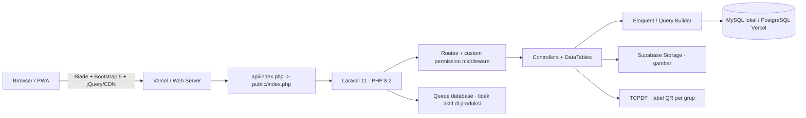
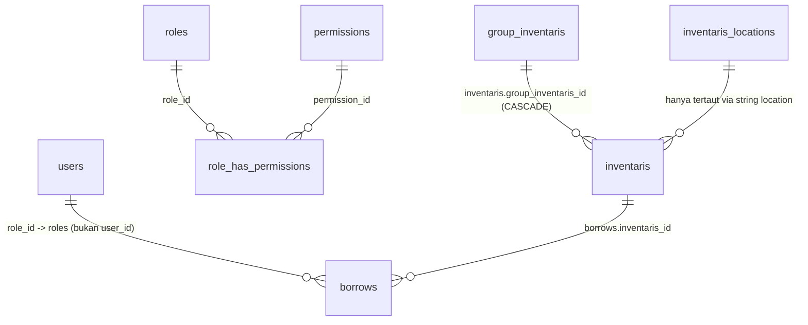

# Inventaris-Web — Dokumentasi Teknis: Alur, Algoritma & Saran Optimasi

> Disusun: 2026-11-25 · Snapshot kode: commit/worktree saat ini · Penulis: tinjauan senior engineer (10+ tahun)
> Semua referensi ditulis `path/ke/file:baris` relatif terhadap root repository.
> Dokumen ini **deskriptif** (apa yang terjadi di kode) + **preskriptif** (apa yang sebaiknya dilakukan). Bagian yang belum bisa dipastikan ditandai eksplisit.

---

## 0. Ringkasan eksekutif

Aplikasi ini adalah sistem inventaris berbasis Laravel 11 yang mengelola: grup barang, barang, lokasi, peminjaman/pengembalian, pengecekan kondisi, QR code, dan manajemen akses. Frontend memakai Blade + Bootstrap/jQuery DataTables dari CDN (bukan Vite), backend memakai Eloquent + Spatie Permission + Yajra DataTables, penyimpanan gambar di Supabase Storage, dan cetak label PDF memakai TCPDF.

Kondisi saat ini: **fitur inti berjalan, tetapi ada utang teknis kritis di empat area** — keamanan akses, integritas siklus peminjaman, konsistensi sistem permission, dan performa query. Temuan paling mendesak:

| # | Temuan | Dampak | Ref |
|---|---|---|---|
| 1 | `APP_KEY` dan `APP_DEBUG=true` tertanam di `vercel.json` (file ter-track) | Session/enkripsi bisa dipalsukan; env bocor lewat halaman error | `vercel.json:25-27` |
| 2 | `qr_data` hasil scan langsung dipakai `redirect()->away()` | Open redirect → phishing | `app/Http/Controllers/QrCodeController.php:17-20` |
| 3 | Route `/qr/{id?}` publik, di luar grup `auth` | Data barang bisa di-enumerasi siapa pun | `routes/web.php:20`, `app/Http/Controllers/InventarisController.php:204-208` |
| 4 | Status peminjaman bebas teks lalu disisipkan ke HTML `rawColumns` | Stored XSS | `BorrowController.php:58,147`, `app/DataTables/BorrowDataTable.php:25-31,112` |
| 5 | `CekController::update` menulis 8 field dari request tanpa validasi | Field sensitif tertimpa; `group_inventaris_id` jadi NULL | `app/Http/Controllers/CekController.php:30-58` |
| 6 | `is_borrow` tidak konsisten di create/update/delete; tanpa lock | Double borrow, barang "hantu dipinjam", stok membengkak | `BorrowController.php:93-268` |
| 7 | Dua sumber kebenaran role (`users.role_id` vs pivot Spatie) | Hak akses bisa berbeda antar halaman | `app/Http/Middleware/CheckPermission.php:23`, `RolePermissionController.php:69` |
| 8 | `hasPermission()` dipanggil per baris DataTables (2 query/panggilan) | 20–40 query ekstra per request AJAX | `app/Helpers/PermissionHelper.php:14-24`, `app/DataTables/BorrowDataTable.php:88,95` |
| 9 | Edit form memakai `$request->id`, bukan parameter route `$id` | Form edit tidak memuat data lama | `InventarisController.php:47`, `UserController.php:24`, `GroupInventarisController.php:35` |
| 10 | Scheduler overdue tidak aktif di Laravel 11 + Vercel | Command `borrows:check-overdue` tidak pernah jalan | `bootstrap/app.php:7-19`, `app/Console/Kernel.php:18-21`, `vercel.json` |

Rekomendasi urutan kerja: **P0 (keamanan + integritas data) → P1 (performa + konsistensi) → P2 (maintainability + test)**, detail di §5.

---

## 1. Arsitektur & stack

### 1.1 Komponen



- Dependensi inti: `laravel/framework ^11`, PHP `^8.2` (`composer.json:12,16`), Spatie Permission `6.16.0`, Yajra DataTables `v11.1.6`, TCPDF `6.8.2`, Carbon `3.8.6`, Guzzle; frontend: jQuery/DataTables CDN, ApexCharts, html5-qrcode, Bootstrap 5 CSS + Bootstrap 4.6 JS (`composer.json`, `package.json:24`, `resources/views/layouts/app.blade.php:13-14,155-165`).
- Bootstrap Laravel 11 memakai `Application::configure()` (`bootstrap/app.php:7-19`); **tidak ada `app/Http/Kernel.php`**. Alias `permission` ditimpa oleh middleware sendiri (`bootstrap/app.php:14-16`).
- `@vite` dinonaktifkan di layout utama (`resources/views/layouts/app.blade.php:40`), sehingga `resources/js/app.js:1-8` (Alpine, plugin DataTables, html5-qrcode) tidak pernah dimuat lewat layout. Scanner memakai CDN versi 2.3.7 (`resources/views/qr_scan.blade.php:14`) padahal lockfile 2.3.8.
- PWA tidak fungsional: service worker di-unregister di layout (`layouts/app.blade.php:70-80`), registrasi di meta dikomentari (`resources/views/vendor/laravelpwa/meta.blade.php:33-47`), dan path cache `/offline` tidak cocok dengan route vendor `/offline/` (`public/serviceworker.js:3`).

### 1.2 Konfigurasi & deploy

| Aspek | Lokal | Vercel | Catatan |
|---|---|---|---|
| DB | MySQL (`.env:27-32`) | `DB_CONNECTION=pgsql` saja (`vercel.json:37`) | Host/user/pass/db tidak ada di `vercel.json`; migrasi memakai `after()` dan seeder memakai `SET FOREIGN_KEY_CHECKS` (MySQL-only) → tidak portabel ke Postgres |
| Cache | `CACHE_STORE=file` (`.env:48`) | `CACHE_DRIVER=array` (`vercel.json:34`) | `config/cache.php:18` membaca `CACHE_STORE`, jadi `CACHE_DRIVER` legacy diabaikan → default `database` aktif |
| Session | `file` (`.env:38`) | `cookie` (`vercel.json:36`) | Cookie session ~4 KB; `SESSION_SECURE_COOKIE` tidak diset |
| Debug | `APP_DEBUG=true` (`.env:4`) | `APP_DEBUG=true` (`vercel.json:25`) | Harus `false` di produksi |
| URL | `https://invengo.freehosting.dev/` | `https://siar.vercel.app` | `APP_URL` juga beda di `.env.example:7`; QR yang dicetak di satu env akan mengarah ke domain lain |
| Scheduler | — | tanpa `crons` | `app/Console/Kernel.php:18-21` tidak dibootstrap di Laravel 11 |

---

## 2. Model data & skema

### 2.1 ERD (relasi yang sebenarnya di database)



Tabel inti (hasil akhir urutan 33 migrasi):

- **`users`**: `id, name, email (UNIQUE), password, role_id (DEFAULT 1, FK → roles.id)`, timestamp.
- **`inventaris`**: `id, group_inventaris_id (FK CASCADE, nullable), name, serial_number (UNIQUE, nullable), image, specification (varchar 255, nullable), condition, status (nullable), qr_link (nullable), location (TEXT), quantity (int nullable), broken_description, is_borrow (tinyint DEFAULT 0), type, deleted_at`.
- **`borrows`**: `id, inventaris_id (FK), date_borrow, status, date_back (nullable), max_return_date (nullable), img_borrow (TEXT NOT NULL), borrow_by (string), quantity (int DEFAULT 1), deleted_at`. **Kolom `user_id` sudah di-drop** (`2025_03_12_233825_update_table_borrows.php:16-19`).
- **`group_inventaris`**: `id, name, type, image` (tanpa soft delete, tanpa unique).
- **`inventaris_locations`**: `id, location, deleted_at` (tanpa unique/index pada `location`).
- **Spatie**: `roles, permissions, model_has_roles, model_has_permissions, role_has_permissions` (`database/migrations/2025_02_07_055401_create_permission_tables.php`).

### 2.2 Inkonsistensi yang perlu diketahui sebelum optimasi

1. **Relasi Eloquent rusak/terbalik**
   - `Inventaris::groupInventaris()` = `hasMany(GroupInventaris::class)` dan `GroupInventaris::inventaris()` = `belongsTo(Inventaris::class)` (`app/Models/Inventaris.php:28-31`, `app/Models/GroupInventaris.php:9-12`) → keduanya mencari `group_inventaris.inventaris_id` yang tidak ada. Seharusnya `Inventaris::group()` → `belongsTo(GroupInventaris::class, 'group_inventaris_id')` dan `GroupInventaris::inventaris()` → `hasMany(Inventaris::class, 'group_inventaris_id')`.
   - `User::borrow()` dan `Borrow::user()` masih mengacu `borrows.user_id` yang sudah dihapus (`app/Models/User.php:52-54`, `app/Models/Borrow.php:30-33`). Peminjam saat ini adalah string `borrow_by`.
2. **Dual sistem role**: `users.role_id` dipakai middleware/helper/Blade (`CheckPermission.php:23`, `PermissionHelper.php:14`, `AppServiceProvider.php:45`), sedangkan `syncPermissions()` dan `hasPermissionTo()` memakai pivot Spatie (`RolePermissionController.php:69`, `resources/views/permission/role-form.blade.php:21`). Seeder mengisi `role_has_permissions` dan `users.role_id`, tetapi **tidak pernah mengisi `model_has_roles`** (`RolePermissionSeeder.php:22-25,31-33,91-99`) → `HasRoles` di `User.php:16` tidak fungsional.
3. **Migrasi duplikat/no-op**: `serial_number` didefinisikan 3× (final: nullable + UNIQUE), `max_return_date` dua kali (yang April no-op), `2025_04_12_012911_*` dan `2025_04_12_053101_*` kosong; `down()` dari `2025_03_21_000001_*` dikomentari → tidak reversible. `inventaris.quantity` di-`change()` menjadi nullable tanpa mendeklarasi ulang default (verifikasi dengan `SHOW CREATE TABLE`).
4. **Index yang belum ada**: `deleted_at` di 3 tabel soft-delete, `borrows(status, max_return_date)`, `borrows.borrow_by`, `borrows.date_borrow/date_back`, `inventaris(condition, status, type, name, location)`, `inventaris(group_inventaris_id, deleted_at)`, `inventaris_locations.location`. Filter `LIKE '%q%'` tidak memakai index B-tree meskipun index ditambahkan.
5. **Cascade menyesatkan**: `inventaris.group_inventaris_id` memakai `ON DELETE CASCADE` (`2025_04_12_061747_*php:17-20`), tetapi `GroupInventarisController.php:126-130` menangkap error FK dengan pesan "masih memiliki barang" — pesan itu tidak akan muncul; hapus grup justru menghapus semua barang beserta record peminjaman terkait.
6. **Kolom gambar salah**: `InventarisController.php:216` dan `GroupInventarisController.php:118` mengecek `$data->img_borrow`; kolom model adalah `image` (`app/Models/Inventaris.php:20`) → file Supabase menjadi orphan.
7. **Seeder tidak portabel & kredensial demo**: `SET FOREIGN_KEY_CHECKS` MySQL-only (`RolePermissionSeeder.php:19,28`), `role_id = 1` hard-coded (`41,50,91`), password demo lemah (`40,49`), dan `DatabaseSeeder.php:14-22` tidak memanggil seeder ini. Factory juga tidak mengisi `role_id` (`database/factories/UserFactory.php:26-32`) → test gagal FK saat `roles` kosong.

### 2.3 Permission seeder

3 role: `admin`, `teknisi`, `guru` (`RolePermissionSeeder.php:31-33`). **28 permission** dalam 8 grup (`RolePermissionSeeder.php:55-84`): inventaris (6 + 4 lokasi), peminjaman (4), scan (2), user (4), role (4), dashboard (2), cek (2). Semua permission diberikan ke `role_id = 1` (`:91-99`); role lain tidak mendapat permission sama sekali.

Semantics penting: middleware, helper, dan Blade directive memakai `whereIn(...)` → **OR** (`CheckPermission.php:32`, `PermissionHelper.php:23`, `AppServiceProvider.php:55`). Jadi `permission:CREATE_INVENTARIS,EDIT_INVENTARIS` berarti "cukup salah satu", bukan "keduanya" seperti konvensi Spatie.

---

## 3. Alur aplikasi (end-to-end)

### 3.1 Autentikasi & resolusi akses

1. Login: `routes/auth.php:20-23` → `AuthenticatedSessionController@store` (`app/Http/Controllers/Auth/AuthenticatedSessionController.php:25-32`) → throttle 5 attempt/email+IP (`app/Http/Requests/Auth/LoginRequest.php:60-84`) → redirect `dashboard`. Registrasi dinonaktifkan (`routes/auth.php:15-18`); user dibuat admin lewat `/users/store`.
2. Setiap request melewati `auth` + `permission:<nama>` (`routes/web.php:22-181`). `CheckPermission::handle()` (`app/Http/Middleware/CheckPermission.php:13-40`):
   - `Auth::check()` gagal → `abort(403)` (bukan redirect login);
   - baca `users.role_id` (query #1);
   - `EXISTS` join `role_has_permissions` + `permissions` dengan `whereIn` (query #2);
   - gagal → `redirect()->back()->with('error', ...)` (302, bukan 403/JSON).
3. UI menyembunyikan tombol via `@hasPermission` (`AppServiceProvider.php:37-57`) DataTables via helper `hasPermission()` (`PermissionHelper.php:7-25`). Keduanya mengulang query yang sama;lihat §4-A1 untuk risikonya.

### 3.2 Dashboard

`GET /` → `DasboardController@index` → view `dashboard.blade.php`. Grafik ApexCharts fetch `GET /chart_data` (`dashboard.blade.php:56-87`) → `chartData()` menghitung 4 `count()` terpisah (`DasboardController.php:18-21`). Catatan: `BorrowCount` menghitung **semua status**, bukan hanya pinjaman aktif.

### 3.3 Inventaris: grup → barang → PDF

```mermaid
flowchart TD
    A[GET /inventaris/ · GroupInventarisController@index] --> B[GroupInventaris paginate(8) + 3 count per kartu di Blade]
    B --> C[GET /inventaris/group/{id} · InventarisController@index]
    C --> D[count total/Rusak/Normal + query LIKE + paginate(10)]
    D --> E[GET /inventaris/form/{group}/{id?} · form]
    E --> F[POST /inventaris/store · validasi + upload Supabase + save]
    F --> G[generate qr_link = route('test_qr', id) lalu save ke-2]
    G --> H[GET /inventaris/show/{id} atau GET /inventaris/pdf/{group}]
    H --> I[TCPDF: 7 barang/halaman + write2DBarcode per item]
```

- `store()` validasi aktif hanya `name, serial_number, condition, specification, location, image` (`InventarisController.php:92-111`); `type` dan `quantity` tetap diassign dari request (`:130-131`) meski aturannya ada di blok komentar (`:54-90`) → berisiko NULL.
- `form()` memakai `$request->id` padahal route param-nya `{id?}` (`:45-49`) → edit tidak memuat data.
- Pencarian form di `resources/views/inventaris/index.blade.php:82` mengirim ke `inventaris.index` (halaman **grup**), bukan `inventaris.inventaris` yang punya logika pencarian barang → pencarian dari halaman barang tidak bekerja.

### 3.4 Peminjaman & pengembalian (alur kritis)

```mermaid
flowchart TD
    S[POST /borrow/store] --> V[Validator: required, exists, date, image]
    V --> T[DB::beginTransaction]
    T --> U[Upload img_borrow ke Supabase · md5 nama+time]
    U --> W[Simpan Borrow]
    W --> X[Inventaris::find(id) -> is_borrow = 1]
    X --> Y[commit + redirect]
    R[PUT /borrow/update/{id}] --> V2{status == 'Dikembalikan'}
    V2 -->|ya| RST[Inventaris is_borrow = 0]
    V2 -->|tidak| KEEP[flag tetap 1]
    D[DELETE /borrow/delete/{id}] --> Q[quantity += borrow.quantity · is_borrow TIDAK direset]
```

Kode: `BorrowController.php:46-131` (store), `:133-242` (update), `:244-268` (delete). Form hanya menawarkan `Dipinjam`/`Dikembalikan` (`resources/views/borrow/form.blade.php:76-85`), tetapi validasi controller hanya `required`, bukan `in:...` (`:58,147`). Aturan tanggal `after_or_equal` juga dinonaktifkan (`:56-57,145-146`) meski pesan errornya masih ada (`:68,71,157,160`). Daftar barang di form difilter `is_borrow = 0` (`:35-41`).

Masalah alur:
- `store()` **tidak mengecek** `is_borrow` dan tidak ada `lockForUpdate()` → dua request konkuren bisa meminjam unit yang sama (§4-A3).
- `update()` memanggil `Inventaris::findOrFail($request->inventaris_id)` **sebelum validasi** (`:136`) → input buruk menghasilkan 404, bukan error validasi; `inventaris_id` bisa diubah client sehingga flag di-reset pada barang yang salah (`:222,231-234`).
- `destroy()` menambah `quantity` padahal `store()` tidak pernah menguranginya (`:115-117` dikomentari) → stok membengkak; `is_borrow` tidak dikembalikan ke 0.
- Transisi `Dikembalikan → Dipinjam` tidak menaikkan `is_borrow`.
- Upload/delete Supabase berada di dalam transaksi DB tetapi **tidak ikut rollback**, dan return value diabaikan (`:109,186,194,253`).
- JS form memakai `#available_quantity` dan `#quantity` yang berada di blok HTML yang dikomentari (`borrow/form.blade.php:56-63,112-136`) → `TypeError` saat halaman dimuat.

### 3.5 Pengecekan kondisi

`GET /cek/` → `CekDataTable` → `GET /cek/{id}` → form → `PUT /cek/{id}` → `CekController@update` (`CekController.php:27-61`). Validasi hanya `image` + `condition`, tetapi controller menimpa `name, specification, condition, location, qr_link, broken_description, type, quantity, group_inventaris_id` (`:47-57`). Form mengambil `group_inventaris_id` dari `request()->route('group_inventaris_id')` (`cekInventaris/form.blade.php:107-110`), padahal route `/cek/{id}` hanya punya parameter `{id}` (`routes/web.php:176-177`) → nilai hidden kosong dan `group_inventaris_id` ditulis NULL. `condition` tidak divalidasi `in:Rusak,Normal`; `broken_description` tidak wajib saat `Rusak`.

### 3.6 QR code: buat → cetak → pindai

```mermaid
flowchart LR
    A[save inventaris dapat id] --> B[qr_link = route('test_qr', id) · /qr/{id}]
    B --> C1[Blade: QrCode::size(50)->generate(qr_link)]
    B --> C2[TCPDF write2DBarcode(qr_link, QRCODE,M, 15mm)]
    C1 --> D[Scan: html5-qrcode -> hidden qr_data -> POST /process-scan]
    C2 --> D
    D --> E[redirect()->away(qr_data) · TANPA validasi]
    E --> F[GET /qr/{id} · publik · showQrData]
```

Referensi: `InventarisController.php:136,188,294`, `CekController.php:53`, `routes/web.php:20,30-35`, `resources/views/inventaris/index.blade.php:87-112`, `resources/views/qr_scan.blade.php:10-64`, `QrCodeController.php:14-21`. QR berukuran 50 px dan seluruh kartu adalah `<a>` ke `inventaris.show` → QR tidak bisa diklik langsung ke `/qr/{id}`.

### 3.7 Notifikasi keterlambatan

- Topbar setiap halaman: `Borrow::where('status','Dipinjam')->where('max_return_date','<', now()->format('Y-m-d'))->count()` (`resources/views/components/topbar.blade.php:34-37`) → query di **setiap** render halaman.
- `GET /notifications/overdue` (`routes/web.php:180`, **hanya `auth`**) → `NotificationController.php:13-19` mengambil semua baris overdue (tanpa pagination) → view menghitung `abs(Carbon::parse(...)->floatDiffInDays(now()))` (`resources/views/notifications/overdue.blade.php:39-51`).
- Command `borrows:check-overdue` (`CheckOverdueBorrows.php:16`) hanya `Log::warning` per baris (`:36-46`), tidak mengubah status dan tidak mengirim notifikasi. Dijadwalkan di `app/Console/Kernel.php:18-21`, tetapi Laravel 11 memakai kernel default (`bootstrap/app.php:7-19`) → schedule tidak aktif; Vercel juga tanpa `crons`.

### 3.8 Manajemen user & role

- `/users/*` → `UserController`: create/update (`app/Http/Controllers/UserController.php:30-94`) mengubah `users.role_id` saja, tidak pivot Spatie; email tidak divalidasi `unique`, `role_id` tidak `exists`, password tidak `confirmed`; `destroy()` (`:96-111`) mengizinkan user menghapus akun sendiri.
- `/roles/*` → `RolePermissionController`: `updateRolePermissions()` memanggil `syncPermissions($request->permissions)` (`RolePermissionController.php:69`) tanpa memvalidasi array → jika `permissions[]` tidak dikirim, semua permission role hilang. Rename + sync tanpa transaksi (`:66-69`). `form()` memanggil `findOrFail($id)` padahal route mengizinkan `{id?}` (`:27` vs `routes/web.php:160`) → 404 saat create lewat halaman form.

### 3.9 Peta route ringkas

| Modul | Route utama | Permission | Ref |
|---|---|---|---|
| Publik | `GET /qr/{id?}` | — | `routes/web.php:20` |
| Dashboard | `GET /`, `GET /chart_data` | `VIEW_DASHBOARD`, `CHART_DATA` | `routes/web.php:23-28` |
| QR scan | `GET /scan`, `POST /process-scan` | `VIEW_SCAN`, `SCAN_PROCESS` | `routes/web.php:30-35` |
| Inventaris | `/inventaris/*` (group, barang, form, PDF) | `VIEW/CREATE/EDIT/DELETE/SHOW/PDF_INVENTARIS` | `routes/web.php:49-96` |
| Lokasi | `/inventaris-location/*` | `*_LOCATION_INVENTARIS` | `routes/web.php:100-112` |
| Peminjaman | `/borrow/*` | `VIEW/CREATE/EDIT/DELETE_BORROW` | `routes/web.php:121-136` |
| User & role | `/users/*`, `/roles/*` | `VIEW/CREATE/EDIT/DELETE_USERS\|ROLES` | `routes/web.php:139-172` |
| Cek | `GET /cek/`, `GET\|PUT /cek/{id}` | `VIEW_CEK`, `PROCESS_CEK` | `routes/web.php:175-178` |
| Notifikasi | `GET /notifications/overdue` | hanya `auth` | `routes/web.php:180` |
| Auth | login/lupa sandi/verifikasi/konfirmasi/logout | `guest`/`auth` | `routes/auth.php:20-58` |

---

## 4. Algoritma yang ada di project

Berikut algoritma/business rule yang benar-benar diimplementasikan, beserta kompleksitas dan kelemahannya. `N` = jumlah baris inventaris, `B` = jumlah pinjaman, `R` = jumlah baris DataTables per halaman, `P` = jumlah permission.

### A1 — Pengecekan hak akses (custom, 3 implementasi)

**Lokasi**: `app/Http/Middleware/CheckPermission.php:13-40`, `app/Helpers/PermissionHelper.php:7-25`, `app/Providers/AppServiceProvider.php:37-57`.

```text
INPUT: user terautentikasi, daftar permission P_req
1. jika !Auth::check() -> false / 403
2. role_id <- SELECT role_id FROM users WHERE id = auth.id        [query 1]
3. jika role_id kosong -> false
4. EXISTS(
     SELECT 1 FROM role_has_permissions rhp
     JOIN permissions p ON p.id = rhp.permission_id
     WHERE rhp.role_id = role_id AND p.name IN (P_req)             [query 2]
   )
5. return hasil EXISTS (OR semantics)
OUTPUT: boolean / lanjut / redirect back
```

**Kompleksitas**: 2 query SQL per pemanggilan; `O(P_req)` untuk `IN` dengan index PK `role_has_permissions(role_id, permission_id)`. **Masalah**: helper dipanggil di dalam closure per baris DataTables (`BorrowDataTable.php:88,95`, `UsersDataTable.php:44,51`, `RolesDataTable.php:32,39`, `CekDataTable.php:31`, `InventarisLocationDataTable.php:31,44`) → `O(R)` pemanggilan ≈ `4R` query per request. Blade directive juga mengembalikan objek `RedirectResponse` saat `role_id` kosong (`AppServiceProvider.php:47-49`) yang bersifat **truthy** → tombol tetap tampil. Cache Spatie (`config/permission.php:168-190`, 24 jam) tidak terpakai.

### A2 — Filter & agregasi inventaris

**Lokasi**: `InventarisController.php:24-43`, `resources/views/groupInventaris/index.blade.php:57-60`, `DasboardController.php:16-35`.

```text
1. title <- SELECT name FROM group_inventaris WHERE id = groupId
2. total  <- COUNT(*) WHERE group_inventaris_id = groupId
3. rusak  <- COUNT(*) WHERE group_inventaris_id = groupId AND condition = 'Rusak'
4. normal <- COUNT(*) WHERE group_inventaris_id = groupId AND condition = 'Normal'
5. rows <- SELECT * WHERE group_inventaris_id = groupId
          [+ WHERE name LIKE %q% OR condition LIKE %q% OR location LIKE %q%]
          ORDER BY created_at DESC LIMIT 10 OFFSET page
```

**Kompleksitas**: 4 query + full scan `O(N)` untuk `LIKE '%q%'`; halaman grup melakukan **3 query count di dalam loop 8 kartu** → ~24 query. `Condition` tidak ber-index. Perbaikan: satu `withCount()` (§5-P1-1) dan satu query agregat `SUM(CASE WHEN ...)`.

### A3 — State machine peminjaman (implementasi saat ini)

**Lokasi**: `BorrowController.php:93-268`.

```text
CREATE:
  jika validasi lolos:
    upload gambar -> INSERT borrows(status = input bebas)
    UPDATE inventaris SET is_borrow = 1 WHERE id = input.inventaris_id
    (tanpa cek is_borrow saat ini, tanpa lock, quantity tidak disentuh)

UPDATE:
  borrow <- findOrFail(id); inventaris <- findOrFail(input.inventaris_id)
  jika input.status == 'Dikembalikan': UPDATE inventaris SET is_borrow = 0

DELETE:
  UPDATE inventaris SET quantity = quantity + borrow.quantity
  DELETE borrows  (is_borrow tidak diubah)
```

**Kompleksitas**: `O(1)` per operasi DB, 3–5 round-trip; tapi **tidak atomic secara logika** (upload di luar rollback DB, tidak ada lock) → race condition dan state divergen. Status bukan enum/check constraint (`borrows.status` varchar), transisi tidak divalidasi.

**Algoritma target (disarankan)**:

```text
BORROW(item_id, qty, dates):
  BEGIN TRANSACTION
    item <- SELECT * FROM inventaris WHERE id = item_id FOR UPDATE
    REQUIRE item exists AND item.is_borrow = 0 AND item.quantity >= qty
    INSERT borrows(..., status = 'Dipinjam')
    UPDATE inventaris SET quantity = quantity - qty, is_borrow = 1 WHERE id = item_id
  COMMIT
  // upload gambar dilakukan SEBELUM txn; hapus objek storage via kompensasi/queue saat gagal

RETURN(item_id):
  BEGIN TRANSACTION
    borrow <- SELECT ... FOR UPDATE
    REQUIRE borrow.status = 'Dipinjam'
    UPDATE borrows SET status = 'Dikembalikan', date_back = today WHERE id = ...
    UPDATE inventaris SET quantity = quantity + borrow.quantity, is_borrow = 0
       WHERE id = borrow.inventaris_id
  COMMIT

DELETE(borrow_id):
  hanya izinkan status = 'Dikembalikan' -> hapus record; jangan pernah menambah quantity
```

Implementasi Laravel (idomatis Laravel 11):

```php
DB::transaction(function () use ($request) {
    $item = Inventaris::whereKey($request->integer('inventaris_id'))
        ->lockForUpdate()->firstOrFail();

    abort_unless($item->is_borrow == 0 && $item->quantity > 0, 422, 'Barang tidak tersedia');

    Borrow::create([...]);              // status dari Rule::in, bukan input bebas
    $item->decrement('quantity');
    $item->update(['is_borrow' => 1]);
});
```

### A4 — Deteksi keterlambatan

**Lokasi**: `NotificationController.php:13-19`, `CheckOverdueBorrows.php:30-46`, `topbar.blade.php:34-37`.

```text
overdue = { borrow | borrow.status == 'Dipinjam'
                   AND borrow.max_return_date < hari_ini }
days_overdue = now()->diffInDays(max_return_date)     // command
```

**Kompleksitas**: `O(B)` full scan because `(status, max_return_date, deleted_at)` belum ber-index. **Bug terukur**: Carbon 3.8.6 `diffInDays($date)` mengembalikan `float` **negatif** untuk tanggal lalu. Verifikasi di environment ini:

```text
Carbon::now()->diffInDays(Carbon::parse('2026-11-20'))            = -5.6170433938889
Carbon::now()->startOfDay()->diffInDays(Carbon::parse('2026-11-20'), true) = 5
```

Jadi log `days_overdue` di `CheckOverdueBorrows.php:42` salah tanda dan bernilai desimal. Kriteria juga didefinisikan 3× dengan perbandingan berbeda (`Carbon::now()->startOfDay()` vs string `format('Y-m-d')`); view `notifications/overdue.blade.php:39-51` sudah memakai `abs()`, tetapi tetap float.

**Algoritma target**:

```php
$today = now()->startOfDay();
Borrow::where('status', 'Dipinjam')
    ->whereNotNull('max_return_date')
    ->where('max_return_date', '<', $today)
    ->chunkById(500, function ($borrows) use ($today) {
        foreach ($borrows as $b) {
            $days = $today->diffInDays($b->max_return_date->startOfDay()); // int positif
            // kirim notifikasi / log sekali per hari (dedup by id + tanggal)
        }
    });
```

### A5 — QR lifecycle

**Lokasi**: `InventarisController.php:136,188,294`, `CekController.php:53`, `QrCodeController.php:14-21`.

```text
qr_link = route('test_qr', ['id' => $id])  // deterministik dari primary key -> "/qr/{id}"
generate: QrCode::size(50)->generate(qr_link) [Blade] | write2DBarcode(qr_link) [TCPDF]
scan: html5-qrcode -> qr_data -> POST /process-scan -> redirect()->away(qr_data)
```

**Kompleksitas**: `O(1)` per QR, `O(N)` untuk PDF (satu QR per baris). **Masalah**: payload dipercaya mentah (open redirect); QR ditaruh di dalam `<a>` ke halaman detail sehingga tidak mengarah ke `/qr/{id}` saat diklik; data lama dengan `qr_link = NULL` bisa error saat generate. Validasi minimal (same-origin) di §5-P0-2.

### A6 — Pipeline DataTables server-side (Yajra)

**Lokasi**: `app/DataTables/*.php`, mis. `BorrowDataTable.php:119-124`.

```text
1. Model::newQuery() (+ leftJoin sesuai kebutuhan)
2. filterColumn: tanggal d/m/Y -> whereDate, status -> LIKE %q%, nama -> LIKE %q%
3. orderColumn: Kolom custom diurutkan lewat alias SQL
4. addColumn/editColumn: badge status, format Carbon, URL gambar, tombol aksi + hasPermission()
5. rawColumns([...]) -> kirim JSON ke DataTables JS
```

**Kompleksitas**: `O(N log N)` sorting + `O(N)` filter di DB, `O(R)` query permission tambahan. `whereDate()` membungkus kolom dengan fungsi → index tidak terpakai. `catch` kosong pada parsing tanggal (`BorrowDataTable.php:42-44,54-56`) membuat filter invalid diabaikan tanpa pemberitahuan. `rawColumns(['img_borrow','status'])` menyuntik nilai DB tanpa escaping → XSS (§5-P0-4). Join `inventaris` tidak mendapat global scope soft-delete, sehingga nama barang terhapus tetap tampil (`:123`).

### A7 — Upload gambar ke Supabase Storage

**Lokasi**: `app/Services/SupabaseService.php:16-85`.

```text
1. baca env('SUPABASE_URL'), env('SUPABASE_SERVICE_ROLE_KEY'), env('SUPABASE_STORAGE_BUCKET')
2. POST /storage/v1/object/{bucket}/upload/{path} (multipart, Bearer token)
3. sukses hanya jika HTTP 200 -> return path; selain itu null (log saja)
4. delete: DELETE endpoint yang sama -> true/false
```

**Kompleksitas**: I/O jaringan sinkron di dalam request (dan di dalam transaksi DB pada peminjaman). **Masalah**: `env()` langsung → null saat `config:cache` aktif; tanpa timeout/retry; error ditelan; caller menyimpan `filePath` meski upload gagal; nama file `time()_namaAsli` (`InventarisController.php:118,179`) atau `md5(nama.time())` (`BorrowController.php:107,192`) bisa tabrakan; URL bucket di-hard-code di 5 tempat (mis. `app/DataTables/BorrowDataTable.php:63`, `resources/views/inventaris/showQrData.blade.php:13`). Bentuk endpoint `/object/{bucket}/upload/{path}` perlu diverifikasi terhadap versi Supabase yang dipakai (tidak bisa dipastikan dari kode saja).

### A8 — Cetak PDF per grup

**Lokasi**: `InventarisController.php:233-301`.

```text
1. SELECT * FROM inventaris WHERE group_inventaris_id = ?   (tanpa limit)
2. TCPDF A4, margin 10mm, header 4 kolom
3. untuk setiap index i:
     jika i > 0 dan i % 7 == 0 -> AddPage() + ulang header
     tulis name/condition/specification + QR 15mm di tengah kolom
4. Output('inventaris.pdf','D')
```

**Kompleksitas**: `O(N)` memori dan `O(N)` generasi QR; layout hard-coded 7 baris/halaman dan lebar kolom `[50,50,50,40]`. Teks dimasukkan ke `Cell()` tanpa escaping (`:279-281`); `SetAuthor('Rifki')` hard-coded (`:241`). Untuk grup besar, gunakan `chunk()`/cursor atau queue + unduh async.

### A9 — Sinkronisasi permission role

**Lokasi**: `RolePermissionController.php:53-72`, seeder `:91-99`.

```text
1. role <- findOrFail; rename jika nama berubah
2. syncPermissions(request.permissions)   // Spatie: hapus semua pivot lalu insert yang dikirim
```

**Kompleksitas**: `O(P)` delete+insert. **Masalah**: tidak ada validasi `permissions` sebagai array → request tanpa checkbox menghapus seluruh akses role; rename + sync tidak dalam transaksi; disinkron ke pivot Spatie, tetapi runtime memakai `users.role_id` + `role_has_permissions` → perubahan akses lewat form **tidak langsung terasa** di middleware/helper/Blade.

---

## 5. Saran optimasi & perbaikan (prioritas)

### P0 — Segera: keamanan & integritas data

| # | Masalah | Rekomendasi | Ref |
|---|---|---|---|
| P0-1 | `APP_KEY` di `vercel.json`, `APP_DEBUG=true` di produksi | **Rotasi APP_KEY**, hapus dari file ter-track, set via environment Vercel, `APP_DEBUG=false`. Audit session aktif setelah rotasi. | `vercel.json:25-27`, `.env.example:3-4` |
| P0-2 | Open redirect `qr_data` | Validasi `url` + same-origin sebelum redirect (kode di bawah). | `QrCodeController.php:17-20` |
| P0-3 | `/qr/{id}` publik | Pindahkan ke grup `auth` + permission `SHOW_INVENTARIS`, atau pakai signed URL dengan expiry jika memang dibagikan ke pihak luar. | `routes/web.php:20`, `InventarisController.php:204-208` |
| P0-4 | Stored XSS di `status` | `Rule::in(['Dipinjam','Dikembalikan'])` + `e($item->status)` sebelum disisipkan ke HTML; audit semua `rawColumns`. | `BorrowController.php:58,147`, `BorrowDataTable.php:25-31,112` |
| P0-5 | `CekController` menimpa field sensitif | FormRequest: hanya `condition`, `broken_description`, opsional gambar yang dipakai; gunakan `validated()`, jangan baca `$request->*` langsung. | `CekController.php:30-58` |
| P0-6 | Form edit memuat data kosong | Ganti `$request->id` dengan parameter `$id`/`$group_inventaris_id` pada 3 controller. | `InventarisController.php:47`, `UserController.php:24`, `GroupInventarisController.php:35` |
| P0-7 | Race condition + stok divergen | Terapkan algoritma A3 (transaksi + `lockForUpdate` + state machine); hentikan penambahan `quantity` di `destroy()`; konsistenkan `is_borrow` di semua transisi. | `BorrowController.php:93-268` |
| P0-8 | Blade directive mengembalikan redirect (truthy) | Kembalikan `false` saat tanpa role; satukan logika ke satu helper/Spatie. | `AppServiceProvider.php:47-49` |
| P0-9 | Notifikasi overdue tanpa permission | Tambahkan `permission:VIEW_BORROW`; pagination; null-safe saat inventaris di-soft-delete. | `routes/web.php:180`, `NotificationController.php:15-19` |
| P0-10 | Test memakai DB aplikasi & test register sudah usang | Aktifkan SQLite `:memory:` di `phpunit.xml:25-26`, seed role di test, hapus/nonaktifkan `RegistrationTest.php` karena route register mati. | `phpunit.xml`, `tests/Feature/Auth/RegistrationTest.php`, `routes/auth.php:15-18` |

Contoh P0-2:

```php
$validated = $request->validate([
    'qr_data' => ['required', 'url', 'max:2048'],
]);

$url = url($validated['qr_data']);
abort_unless(str_starts_with($url, rtrim(config('app.url'), '/').'/'), 422, 'QR tidak valid');

return redirect($url);
```

Contoh P0-5:

```php
final class UpdateCekRequest extends FormRequest
{
    public function authorize(): bool { return true; } // route sudah di-gate middleware

    public function rules(): array
    {
        return [
            'condition'          => ['required', Rule::in(['Normal', 'Rusak'])],
            'broken_description' => ['required_if:condition,Rusak', 'nullable', 'string'],
            'image'              => ['nullable', 'image', 'mimes:jpg,jpeg,png', 'max:2048'],
        ];
    }
}

// controller:
$data->update($request->safe()->only(['condition', 'broken_description']));
$data->updateQrLink(); // qr_link dihitung ulang dari ID, bukan dari request
```

### P1 — Dekat: performa & konsistensi

| # | Optimasi | Dampak | Ref |
|---|---|---|---|
| P1-1 | `withCount()` di grup inventaris | ~24 query → 1 query per halaman | `groupInventaris/index.blade.php:57-60` |
| P1-2 | Satukan permission ke Spatie (`assignRole`, `hasAnyPermission`) + memoize helper | ~20–40 query → 0–1 query/request; menghilangkan dual source of truth | `PermissionHelper.php`, `CheckPermission.php`, `AppServiceProvider.php`, `RolePermissionController.php:69` |
| P1-3 | Hapus query yang tidak dipakai | `BorrowController::index:25`, `UserController::index:16`, `RolePermissionController::manageRoles:18-19` | — |
| P1-4 | Satu agregat + cache 1 menit untuk dashboard/topbar/grup | Hilangkan 4+ query count per request | `DasboardController.php:18-21`, `topbar.blade.php:34-37`, `InventarisController.php:27-29` |
| P1-5 | Index: `borrows(status,max_return_date,deleted_at)`, `borrows(borrow_by)`, `borrows(date_borrow,date_back)`, `inventaris(group_inventaris_id,deleted_at)`, `inventaris(condition,status)`, `deleted_at` di 3 tabel | Overdue/filter dari full scan → index range scan | lihat §2.2-4 |
| P1-6 | Perbaiki relasi Eloquent + seeder (`assignRole`, hapus password demo, `role_id` dari role yang dibuat, portabel Postgres) | `withCount` bisa dipakai; test tidak gagal FK | §2.2-1, `RolePermissionSeeder.php` |
| P1-7 | `SupabaseService`: `config('services.supabase.*')`, timeout/retry, lempar exception saat gagal, nama file `Str::uuid()`, URL bucket via config | Tidak ada record dengan gambar rusak; aman saat `config:cache` | `SupabaseService.php:18-85`, `InventarisController.php:118,179` |
| P1-8 | Validasi `UserController`: `unique:users,email`, `exists:roles,id`, `confirmed`, larang hapus diri sendiri | Cegah 500 & eskalasi hak | `UserController.php:33-43,96-111` |
| P1-9 | Validasi `syncPermissions` sebagai array + transaksi | Cegah hilangnya semua permission | `RolePermissionController.php:66-69` |
| P1-10 | Aktifkan scheduler Laravel 11 via `withSchedule()`; pastikan cron/worker ada jika dipakai | Command overdue benar-benar jalan | `bootstrap/app.php`, `routes/console.php` |
| P1-11 | Perbaiki JS form borrow & form search inventaris | Hilangkan `TypeError`; pencarian barang bekerja | `borrow/form.blade.php:112-142`, `inventaris/index.blade.php:82` |
| P1-12 | Samakan kriteria overdue + `diffInDays(..., true)` pada `startOfDay()` | `days_overdue` positif & bulat | `CheckOverdueBorrows.php:30-43` |
| P1-13 | Rate limit `throttle:10,1` pada `qr.process` dan mutasi; sanitasi URL gambar | Kurangi abuse | `routes/web.php:33-35` |

Contoh P1-1:

```php
$groups = GroupInventaris::withCount([
    'inventaris as jumlah',
    'inventaris as normal' => fn ($q) => $q->where('condition', 'Normal'),
    'inventaris as rusak'  => fn ($q) => $q->where('condition', 'Rusak'),
])->latest()->paginate(8);
```

Contoh P1-4:

```php
$stats = Inventaris::selectRaw("
    COUNT(*) AS total,
    SUM(CASE WHEN condition = 'Normal' THEN 1 ELSE 0 END) AS normal,
    SUM(CASE WHEN condition = 'Rusak'  THEN 1 ELSE 0 END) AS rusak
")->first();

$stats = Cache::remember('inventaris:stats', now()->addMinute(), fn () => $stats);
```

Contoh P1-2 (setelah role disatukan ke Spatie):

```php
function hasPermission($permissions): bool
{
    static $memo = [];
    $key = auth()->id().'|'.implode(',', (array) $permissions);

    return $memo[$key] ??= auth()->user()?->hasAnyPermission((array) $permissions) ?? false;
}
```

Contoh P1-10:

```php
// bootstrap/app.php
->withSchedule(fn (Illuminate\Support\Facades\Schedule $schedule) =>
    $schedule->command('borrows:check-overdue')->daily())
```

### P2 — Setelah stabil: maintainability & test

- Pindahkan validasi dari 7 controller ke `FormRequest` (`app/Http/Requests/`) dengan `authorize()` + `validated()`; hapus ~200 baris blok komentar dan pesan error duplikat.
- Hapus dead code/import menganggur: `use App\Models\Cek` (`CekDataTable.php:5`, model tidak ada), `Cache`/`Storage` di `InventarisController.php:10-11`, `use illuminate\Support\Str` huruf kecil (`:14`), route/profile yang dikomentari (`routes/web.php:114-118`) tapi view masih merujuknya.
- Konstanta untuk pagination (8/10), 7 baris/PDF, ukuran QR 50, guard `web`, dan batas upload 2 MB.
- Perbaiki config: `CACHE_STORE` (bukan legacy `CACHE_DRIVER`), `SESSION_SECURE_COOKIE`, kredensial DB lengkap di Vercel, satu `APP_URL`, matikan `URL::forceScheme()` hard-coded `APP_PRODUCTION` (`AppServiceProvider.php:33-35`).
- Putuskan nasib PWA: aktifkan service worker (registrasi + `/offline` konsisten + ikon manifest) atau hapus paket/view-nya.
- Aktifkan Vite (`@vite`) dan pakai npm `html5-qrcode` versi lockfile, bukan CDN; hapus duplikasi Bootstrap 4/5 + JS template.
- Tambah test fitur inti (sekarang 100% bawaan Breeze): `BorrowLifecycleTest` (status/flag/stok + konkurensi), `PermissionMiddlewareTest`, `CekValidationTest`, `QrScanTest` (open redirect & akses), `InventarisFormTest` (bug `$request->id`), `SupabaseServiceTest`. Tambah factory `Inventaris`/`Borrow`.

---

## 6. Roadmap & definition of done

| Sprint | Fokus | Done criteria |
|---|---|---|
| 1 | P0-1…P0-10 | APP_KEY dirotasi & `APP_DEBUG=false`; QR route terlindungi & redirect same-origin; `status` ter-validasi & ter-escape; edit form memuat data; siklus pinjam/kembali/hapus konsisten & ada test; test suite hijau di SQLite in-memory. |
| 2 | P1-1…P1-13 | Jumlah query halaman grup ≤ 2; `hasPermission` ≤ 1 query/request; tidak ada query yang dihitung tapi dipakai; index overdue aktif; scheduler berjalan; seeder bisa dijalankan di MySQL **dan** Postgres. |
| 3 | P2 | FormRequest terpusat, dead code dibersihkan, config konsisten, Vite aktif, cakupan test fitur inti ≥ 70%. |

**Regresi yang wajib diuji setelah perubahan**: transisi `Dipinjam → Dikembalikan → Dipinjam kembali`, penghapusan pinjaman aktif vs selesai, hapus grup yang masih punya barang, perubahan role via form, scan QR dari domain lain, cetak PDF grup > 100 barang, akses user `teknisi`/`guru` (saat ini tanpa permission).

---

## 7. Lampiran

### 7.1 Hal yang belum bisa dipastikan dari kode saja

- Bentuk endpoint Supabase Storage yang benar untuk versi yang dipakai (`/storage/v1/object/{bucket}/upload/{path}` di `SupabaseService.php:36,73` vs pola umum `/storage/v1/object/{bucket}/{path}`) — perlu uji langsung.
- Apakah `QueryException::getCode() === '23000'` benar-benar terpenuhi pada driver MySQL/PDO yang dipakai (`InventarisController.php:226`, `GroupInventarisController.php:126`); di Postgres kode SQLSTATE berbeda.
- Default `inventaris.quantity` setelah `->nullable()->change()` — cek `SHOW CREATE TABLE inventaris` / `\d inventaris`.
- Data produksi: apakah ada `qr_link = NULL`, `status` di luar enum yang disarankan, atau `role_id` yang tidak cocok dengan pivot Spatie.

### 7.2 Catatan gaya kode

- Gunakan `Rule::in()` / `FormRequest` untuk setiap field yang memiliki domain nilai tertentu (`Dipinjam|Dikembalikan`, `Normal|Rusak`).
- Semua perubahan skema lewat migrasi baru; jangan mengubah migrasi lama yang sudah dijalankan produksi.
- Simpan upload gambar di luar transaksi DB; jika gagal setelah commit, laporkan lewat queue/Log, jangan biarkan record mengacu ke objek yang tidak ada.
- Hindari `redirect()->back()` untuk penolakan akses pada endpoint yang dipanggil DataTables/AJAX — kembalikan 403/JSON agar tidak membingungkan klien.

### 8 Tambahan
Sebelum gambar atau foto di upload ke storage supabase, kompress dulu sampai file tersebut berukuran dibawah 5 mb, karena saya set limit untuk gambar yang di upload di bucket supabase nya